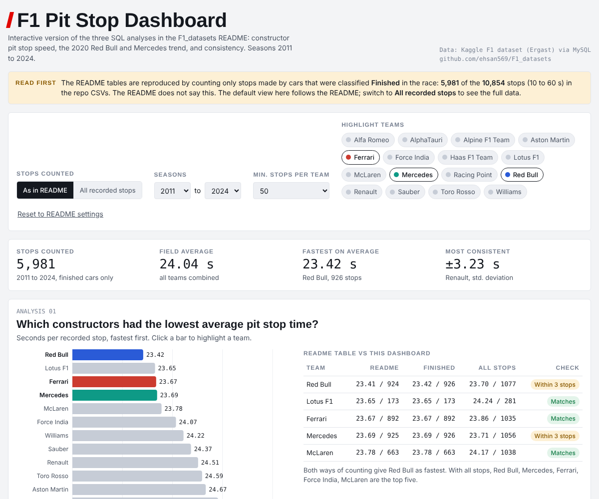

# F1 Race Performance Analysis using MySQL
## Interactive Dashboard

[**Open the live dashboard**](https://ehsan569.github.io/F1_datasets/): filter by season, compare teams, and switch between the README basis (finished cars only) and all recorded stops.

## Project Overview

This project analyses Formula 1 race performance data using MySQL. The aim is to demonstrate SQL querying, data cleaning, exploratory analysis, and business-style insight generation for a data analyst portfolio.

## Dataset Coverage Note

The full dataset covers Formula 1 race data from **1950 to 2024**. However, not every table covers the full period. For example, the `pit_stops` table only contains recorded pit stop data from **2011 onwards**. Therefore, all pit stop analyses in this project are limited to the **2011–2024** period.

## Tools Used

- MySQL Workbench
- VS Code
- GitHub
- Kaggle Formula 1 dataset

## Key SQL Analyses
Pit stop analyses include only stops made by cars classified as Finished, 5,981 of 10,854 stops between 10 and 60 seconds.

### Analysis 01: Recorded Pit Stop Duration by Constructor

Business question: 
Which Formula 1 constructors achieved the lowest average recorded pit stop duration in the dataset?

**Tables used:**  
`pit_stops`, `results`, `constructors`, `races`

**SQL techniques used:**  
`INNER JOIN`, `GROUP BY`, `COUNT()`, `AVG()`, `MIN()`, `MAX()`, `ROUND()`, `HAVING`, filtering

This analysis compared constructors by their average recorded pit stop duration using the `pit_stops`, `results`, `constructors`, and `races` tables.

After filtering for valid pit stop durations between 10 and 60 seconds and requiring at least 50 recorded pit stops per constructor, **Red Bull ranked first** with the lowest average recorded pit stop duration of **23.41 seconds** across **924 pit stops** between **2011 and 2024**.

| Rank | Constructor | Avg recorded pit stop seconds | Total pit stops | Seasons |

| 1 | Red Bull | 23.41 | 924 | 2011–2024 |
| 2 | Lotus F1 | 23.65 | 173 | 2012–2015 |
| 3 | Ferrari | 23.67 | 892 | 2011–2024 |
| 4 | Mercedes | 23.69 | 925 | 2011–2024 |
| 5 | McLaren | 23.78 | 663 | 2011–2024 |

Ferrari, Mercedes, and McLaren also appeared in the top five, suggesting that leading constructors generally maintained strong pit stop operational performance across multiple seasons.

**Important limitation:**  
The dataset appears to record broader pit stop event duration rather than the official stationary tyre-change time shown during Formula 1 broadcasts. Therefore, the results should be interpreted as relative pit stop duration performance within the dataset, not official tyre-change rankings.

### Analysis 02: Rolling Average Pit Stop Trend — Red Bull vs Mercedes, 2020

**Business question:**  
Did Red Bull and Mercedes get faster or slower at recorded pit stop durations as the 2020 season progressed?

**Tables used:**  
`pit_stops`, `results`, `constructors`, `races`

**SQL techniques used:**  
`AVG() OVER`, `PARTITION BY`, `ORDER BY`, `ROWS BETWEEN`, `CTE`, `ROW_NUMBER()`, `COUNT() OVER`, conditional aggregation

This analysis used a rolling average to compare how recorded pit stop duration changed throughout the 2020 season for Red Bull and Mercedes. The rolling average was calculated separately for each constructor using `PARTITION BY`, with pit stops ordered by race round, lap, stop number, and driver ID.

| Constructor | First rolling average seconds | Final rolling average seconds | Change |
|---|---:|---:|---:|
| Mercedes | 21.85 | 25.27 | +3.42 |
| Red Bull | 20.94 | 24.76 | +3.82 |

The results show that both constructors had higher final rolling averages than their first recorded rolling averages. Mercedes increased from **21.85 seconds** to **25.27 seconds**, while Red Bull increased from **20.94 seconds** to **24.76 seconds**.

This suggests that, within the dataset, both teams’ recorded pit stop durations became slower on average as the 2020 season progressed. Red Bull started with a lower recorded pit stop duration than Mercedes and also ended with a lower final rolling average, but both teams followed an upward trend.

**Important limitation:**  
During validation, a data integrity issue was identified where some Red Bull 2020 `driverId` values did not match records in the `drivers` table. To avoid excluding valid Red Bull pit stop records, this analysis focused on constructor-level trends and used `driverId` directly instead of joining to driver names.

### Analysis 03: Pit Stop Consistency by Constructor

**Business question:**  
Which Formula 1 constructors were the most consistent in recorded pit stop duration, not just the fastest on average?

**Tables used:**  
`pit_stops`, `results`, `constructors`, `races`

**SQL techniques used:**  
`INNER JOIN`, `GROUP BY`, `COUNT()`, `AVG()`, `STDDEV()`, `MIN()`, `MAX()`, `ROUND()`, `HAVING`, filtering

Although the full Kaggle Formula 1 dataset covers race data from **1950 to 2024**, the `pit_stops` table only contains recorded pit stop data from **2011 onwards**. Therefore, this pit stop consistency analysis covers the period from **2011 to 2024**, not the full 1950–2024 dataset range.

This analysis compared constructor pit stop consistency using the standard deviation of recorded pit stop durations. While average pit stop duration shows which constructors were fastest overall, standard deviation helps identify which constructors delivered more predictable and consistent pit stop performance.

After filtering for valid recorded pit stop durations between **10 and 60 seconds** and requiring at least **50 recorded pit stops** per constructor, **Renault had the lowest standard deviation at 3.23 seconds**, making it the most consistent constructor in this analysis.

| Rank | Constructor | Avg pit stop seconds | Std dev seconds | Total pit stops | Seasons |
|---:|---|---:|---:|---:|---|
| 1 | Renault | 24.51 | 3.23 | 138 | 2011–2020 |
| 2 | Force India | 24.08 | 3.58 | 325 | 2011–2018 |
| 3 | Ferrari | 23.67 | 3.65 | 892 | 2011–2024 |
| 4 | Red Bull | 23.41 | 3.68 | 924 | 2011–2024 |
| 5 | Lotus F1 | 23.65 | 3.71 | 173 | 2012–2015 |

The results show that **Red Bull had the fastest average recorded pit stop duration**, but **Renault had the most consistent recorded pit stop duration** based on standard deviation. This shows that average speed and consistency are different performance measures.

**Important limitation:**  
The `pit_stops.milliseconds` field appears to represent broader recorded pit stop duration rather than the official stationary tyre-change time shown during Formula 1 broadcasts. Therefore, this analysis should be interpreted as a comparison of recorded pit stop duration consistency within the dataset, not as an official ranking of tyre-change speed.
